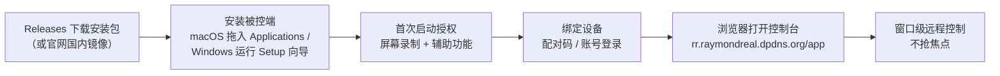

> [English](./README_en.md) | **简体中文**

# RayRemote 被控端下载

**RayRemote 官方安装包分发仓 —— macOS / Windows 被控端，下载即用。**

---

## 这是什么

本仓库是 **[RayRemote](https://github.com/RayMorTwinkle/RayRemote)** 的**被控端下载分发仓**：

- RayRemote 是窗口级远程控制平台 —— 浏览器 viewer 零安装，被控端常驻静默、不抢焦点。
- 这里**只发布安装包**（macOS `.dmg` / Windows `.exe` / 免安装 `.zip`），**不含源码**。
- 源码、架构文档、功能介绍、问题反馈请移步主仓库 [RayMorTwinkle/RayRemote](https://github.com/RayMorTwinkle/RayRemote)。

> 网页控制台（注册 / 登录 / 绑定 / 远程控制）：**https://rr.raymondreal.dpdns.org/app**

---

## 📥 下载

到 **[Releases 页面](https://github.com/RayMorTwinkle/rayremote-release/releases)** 取最新版（tag 形如 `app-YYYY.M.D.NNN`）：

| 平台 | 包 | 说明 |
|---|---|---|
| macOS | `RayRemote-<版本>.dmg` | macOS 14+，打开后拖入 Applications |
| Windows | `RayRemoteSetup-<版本>.exe` | Windows 10+ x64，双击运行的安装向导（推荐） |
| Windows | `RayRemote-windows-amd64.zip` | 免安装 zip 包（高级用户） |

- **校验**：每个安装包附带同名 `.sha256` 文件，下载后可核对完整性（macOS `shasum -a 256`，Windows `certutil -hashfile <文件> SHA256`）。
- **GitHub 打不开 / 太慢？** 官网提供国内高速下载：**https://rr.raymondreal.dpdns.org/**

### 下载 → 被控流程

---

## 🛠️ 安装

### macOS

打开 `.dmg`，将 `RayRemote` 拖入 `Applications`。

**首次打开被 Gatekeeper 拦截？** 这是未签名应用的正常提示。解决：双击一次（弹「无法验证」→ 点「完成」）→ 系统设置 → 隐私与安全性 → 底部「仍要打开」→ 输开机密码。只需一次，`.dmg` 内附同样步骤的说明文件。

启动后按 app 内指引完成授权即可（被控需「屏幕录制」与「辅助功能」权限）。

### Windows

下载 `RayRemoteSetup-*.exe` 双击运行，按向导完成安装与开机自启。未签名版本首次运行会弹 **SmartScreen**，选「仍要运行」即可。

免安装 zip 包：解压后在包目录运行 `install.ps1`（参数见脚本头部注释）。

---

## 🔗 绑定与控制台

安装完成后打开控制面板，任选其一绑定：

- **配对码**：面板生成配对码，在网页端控制台输入确认；
- **账号登录**：面板里直接用云端账号登录并绑定。

没有账号？先在控制台 **https://rr.raymondreal.dpdns.org/app** 注册 —— 注册 / 登录 / 绑定管理 / 远程控制都在浏览器里完成。

---

## ❓ FAQ

**Q：macOS 提示「无法验证开发者」/ Windows 弹 SmartScreen，安全吗？**
A：安装包未做代码签名，系统拦截属正常提示，按上文步骤放行即可。不放心的可核对 `.sha256` 校验值，或等官网渠道下载同一构建。

**Q：为什么启动后要授权「屏幕录制」「辅助功能」？**
A：被控端需要采集画面并注入键鼠输入，这两项是 macOS（TCC）的硬要求；Windows 端对应能力由安装器与 helper 处理。授权异常或重装后权限失效，可按面板内指引清理 TCC 残留条目后重新授权。

**Q：`.dmg` 和 `.zip`（macOS）/ `Setup.exe` 和 `windows-amd64.zip` 该选哪个？**
A：普通用户：macOS 选 `.dmg`、Windows 选 `RayRemoteSetup-*.exe`（含安装向导与开机自启）。`.zip` 为免安装包，适合高级用户自行部署。

**Q：如何更新到新版？**
A：关注 [Releases](https://github.com/RayMorTwinkle/rayremote-release/releases) 获取新包；Windows 安装版控制面板内置自更新与卸载，macOS 下载新 `.dmg` 覆盖安装即可。

**Q：GitHub 下载太慢 / 打不开？**
A：用官网国内镜像 **https://rr.raymondreal.dpdns.org/** 高速下载。

**Q：功能 bug、想要源码或文档？**
A：本仓只做分发。请到主仓库 [RayMorTwinkle/RayRemote](https://github.com/RayMorTwinkle/RayRemote) 提 issue / 看文档。

---

## ⚠️ 注意事项

- 本仓发布物为**未签名构建**，首次运行需按上述步骤放行系统安全提示。
- 被控端常驻后台、静默运行，是远程控制的正常行为；不再使用时请从面板或系统正常卸载。

---

## 📄 License

本仓库仅分发 RayRemote 被控端安装包，不含源码，未附带开源许可证；RayRemote 为专有软件。源码与许可信息见主仓库 [RayMorTwinkle/RayRemote](https://github.com/RayMorTwinkle/RayRemote)。

rayremote-release · 下载即被控，浏览器即控制台

