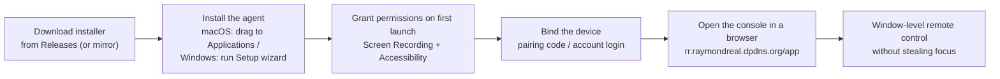

> **English** | [简体中文](./README.md)

# RayRemote Agent Downloads

**Official distribution repo for the RayRemote agent — macOS / Windows installers, ready to run.**

---

## What this is

This repository is the **download distribution channel for the [RayRemote](https://github.com/RayMorTwinkle/RayRemote) agent**:

- RayRemote is a window-level remote-control platform — the browser-based viewer needs zero install, while the agent on the controlled machine runs silently in the background and never steals focus.
- This repo **only publishes installers** (macOS `.dmg` / Windows `.exe` / portable `.zip`); **no source code** lives here.
- For source code, architecture docs, feature details, and issue reports, head to the main repo [RayMorTwinkle/RayRemote](https://github.com/RayMorTwinkle/RayRemote).

> Web console (sign up / log in / bind devices / remote control): **https://rr.raymondreal.dpdns.org/app**

---

## 📥 Download

Grab the latest build from the **[Releases page](https://github.com/RayMorTwinkle/rayremote-release/releases)** (tags look like `app-YYYY.M.D.NNN`):

| Platform | Package | Notes |
|---|---|---|
| macOS | `RayRemote-<version>.dmg` | macOS 14+, open and drag into Applications |
| Windows | `RayRemoteSetup-<version>.exe` | Windows 10+ x64, double-click installer wizard (recommended) |
| Windows | `RayRemote-windows-amd64.zip` | Portable zip package (advanced users) |

- **Verification**: every installer ships with a same-named `.sha256` sidecar file — verify integrity after downloading (`shasum -a 256` on macOS, `certutil -hashfile <file> SHA256` on Windows).
- **GitHub unreachable or slow?** The official site offers a high-speed mirror (China-friendly): **https://rr.raymondreal.dpdns.org/**

### Download → controlled flow

---

## 🛠️ Install

### macOS

Open the `.dmg` and drag `RayRemote` into `Applications`.

**Blocked by Gatekeeper on first launch?** That's the normal prompt for an unsigned app. Fix: double-click once (dialog says "cannot be verified" → click "Done") → System Settings → Privacy & Security → "Open Anyway" at the bottom → enter your login password. One time only — the `.dmg` bundles a note with the same steps.

After launch, follow the in-app prompts to finish granting permissions (controlling requires **Screen Recording** and **Accessibility**).

### Windows

Download `RayRemoteSetup-*.exe`, double-click, and follow the wizard to install and enable auto-start. Unsigned builds trigger a **SmartScreen** prompt on first run — choose "Run anyway".

Portable zip package: extract it, then run `install.ps1` from the package directory (parameters documented in the script header comments).

---

## 🔗 Binding & console

After install, open the control panel and bind the device either way:

- **Pairing code**: the panel generates a code; confirm it in the web console;
- **Account login**: sign in with your cloud account right in the panel.

No account yet? Register at the console **https://rr.raymondreal.dpdns.org/app** — sign-up, login, device binding, and remote control all happen in the browser.

---

## ❓ FAQ

**Q: macOS says "cannot verify developer" / Windows shows SmartScreen — is it safe?**
A: The installers aren't code-signed, so the OS warning is expected. Follow the steps above to allow it. If in doubt, verify the `.sha256` checksum or grab the same build from the official site.

**Q: Why does it ask for "Screen Recording" and "Accessibility" permissions?**
A: The agent must capture the screen and inject keyboard/mouse input — both are hard requirements of macOS (TCC). On Windows the equivalent capabilities are handled by the installer and helper. If permissions break or go stale after reinstalling, follow the in-panel guidance to clear dead TCC entries and re-authorize.

**Q: `.dmg` vs `.zip` (macOS) / `Setup.exe` vs `windows-amd64.zip` — which should I pick?**
A: Regular users: `.dmg` on macOS, `RayRemoteSetup-*.exe` on Windows (wizard + auto-start included). The `.zip` packages are portable builds for advanced users deploying manually.

**Q: How do I update?**
A: Watch [Releases](https://github.com/RayMorTwinkle/rayremote-release/releases) for new packages; the installed Windows panel has built-in self-update and uninstall, and on macOS just install the new `.dmg` over the old app.

**Q: GitHub is slow / unreachable?**
A: Use the official high-speed mirror at **https://rr.raymondreal.dpdns.org/**.

**Q: Feature bugs, source code, or docs?**
A: This repo is distribution-only. Please file issues / read the docs in the main repo [RayMorTwinkle/RayRemote](https://github.com/RayMorTwinkle/RayRemote).

---

## ⚠️ Notes

- These are **unsigned builds** — the first-run OS prompts must be allowed as described above.
- The agent stays resident and silent in the background; that is expected behavior for remote control. Uninstall normally via the panel or the OS when you no longer need it.

---

## 📄 License

This repository distributes the RayRemote agent installers only — no source code is included and no open-source license is granted; RayRemote is proprietary software. See the main repo [RayMorTwinkle/RayRemote](https://github.com/RayMorTwinkle/RayRemote) for source and licensing details.

rayremote-release · Download the agent, control from the browser

